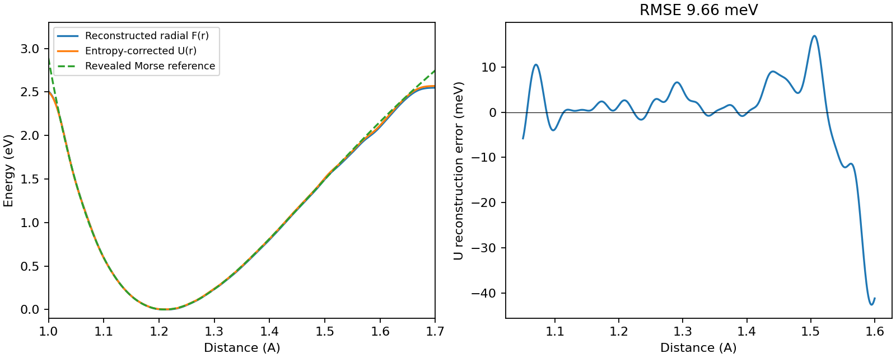

# GPUMD 最小接入验证（2026-10-23）

验证在 310（excelsior）直接通过 SSH 运行，未使用 Slurm。本机仅编辑和读取源码。
硬件为 RTX 4090 D，驱动 550.144.03；CUDA 12.5.40、GCC 9.3.1、CMake 3.22.5，
GPUMD 固定为 v5.9.1。完整数值见 [RESULTS_310.json](RESULTS_310.json)。

最终构建成功，相关 CTest 为 **3/3 通过**：zqc_gpumd_engine、
zqc_gpumd_distance_smoke、zqc_production_cv_views。两次固定种子 smoke 的
HILLS 文件 SHA-256 完全一致（36c53f8a8816fc31…）。

## 已验证的路径

- GPUMD EnhancedSampling → 生产 DISTANCE → CVGraphExecution → BiasSession。
- 坐标/力 SoA、原生九分量 virial、偏置能量加入 GPUMD 的每原子 potential。
- 周期距离、任意 stride、数组地址重绑、跨流就绪等待、已有力的累加、
  两个 CV 对同一原子的梯度累计，以及 Full9 非对称分量保留。
- 原生谐和偏置与 Graph 桥接的能量、力、virial 一致。
- 非线性图 r*r 和 a*b+a 的反传；GPUMD 总能量的中心有限差分最大力误差
  6.98e-9 eV/Å。解析对照的最大绝对误差约 8.9e-16。
- 生产 CV 的独立 View/有限差分回归，包括 LocalQL 的 memcpy 兼容修改。

## 固定种子的 O₂/Morse FES

两原子自由转动，300 K Langevin，步长 0.2 fs，热化 20,000 步，
总计 2,000,000 步（400 ps），种子 73517。WTMetaD 的 sigma=0.015 Å、
height=0.02 eV、biasfactor=20、PACE=100，沉积 19,800 座 hill。

重建程序只读取 HILLS 与采样参数，再由独立验证程序揭示 Morse 势。
比较区间在运行前固定为 1.05–1.60 Å；径向 FES 加入 2 kBT log(r/Å)
后与已知势能比较，仅拟合能量零点。

| 指标 | 结果 | 预设要求 |
|---|---:|---:|
| RMSE | 9.659 meV | <25 meV |
| 最大绝对误差 | 42.638 meV | <75 meV |
| 重建势阱位置 | 1.211 Å | 参考 1.210 Å |
| 轨迹范围 | 1.0160–1.6758 Å | 覆盖比较区间 |
| 墙钟时间 | 205.11 s | 仅记录，未做性能 A/B |



这是单条固定种子的最小接入验收；不代表任意系统的收敛保证或真实 O₂ 电子势能面。
初次探索轨迹使用零初速度，发现它会使 GPUMD 忽略 velocity seed 后，
已修正采样输入并以本表的固定种子轨迹重新验收。静态差分夹具仍使用显式零速度。

## 复测与限制

构建命令和输入见 [README.md](README.md)。本机驱动/工具链下曾有一次 CUDA
延迟模块加载时报 out of memory，当时 GPU 空闲。后续验收显式使用
`CUDA_MODULE_LOADING=EAGER` 并通过；该记录不将这次初始化失败归因为显存不足。

运行命令示例：

```sh
CUDA_MODULE_LOADING=EAGER ctest --test-dir build/gpumd \
  -R 'zqc_gpumd|zqc_production_cv_views' --output-on-failure
CUDA_MODULE_LOADING=EAGER python benchmarks/gpumd/run.py \
  --gpumd build/gpumd/bin/gpumd_metadtoy --mode fes --steps 2000000 \
  --seed 73517 --output build/gpumd-o2
python benchmarks/gpumd/reconstruct.py build/gpumd-o2
python benchmarks/gpumd/validate_fes.py build/gpumd-o2
```

GPUMD 适配器当前支持固定顺序、单进程、正交固定盒、DISTANCE 和单输出图。
DISTANCE 点名坐标传到 Host，全局标量图在 Host 求值；接入中没有逐步 Python 调用。
尚未开放邻居表 CV、NPT 和完整 MD 重启。这些配置会明确报错。

远端原始数据位于 `/home/saitang/work/MetadToy-gpumd-20261023/build/gpumd-o2-seeded-2m`。
本地原始数据保存在 `build/gpumd-validation-310/gpumd-o2-seeded-2m`。
