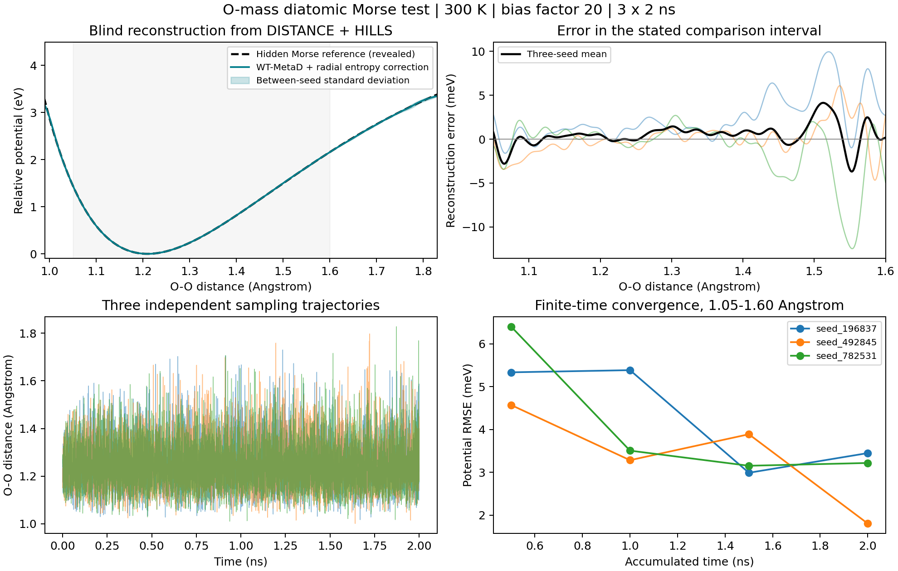

# DISTANCE 驱动的 O₂ Morse 重建验证

两个质量为 15.999 amu 的原子用 Morse 势产生运动，Graph 只接收 `DISTANCE 1 2`。这是经典示例模型；参数未经真实 O₂ 电子结构数据拟合。目标是验证 DISTANCE → Graph → 偏置力 → HILLS → 曲线重建的完整流程。

## 运行与重建

```bash
python benchmarks/o2_distance/run.py --output build/o2-distance-new
python benchmarks/o2_distance/reconstruct.py build/o2-distance-new
python benchmarks/o2_distance/validate.py build/o2-distance-new
```

`run.py` 可传 `--plugin`、`--lammps`、`--steps`、`--seeds`，输出目录须尚不存在。Python 分析需要 numpy、matplotlib；运行阶段调用 LAMMPS 可执行文件。依赖路径可由命令行、环境变量、插件构建缓存及 PATH 提供。完整输入见 [in.lammps](in.lammps)，单独运行时用 `lmp_mpi -var plugin /absolute/path/fix_crystallize_plugin.so -in in.lammps`。

- `run.py` 保存 `reference_model.json`、`sampling.json` 和每个种子的输入、HILLS、距离/偏势轨迹、日志。
- `reconstruct.py` 读取 sampling.json、HILLS 和距离轨迹，不读取参考参数、底层势能或力；输出各检查点自由能与重建势能、访问次数和种子平均曲线。
- `validate.py` 在重建完成后读取参考模型，输出误差、PNG/PDF 对照图；默认长轨迹要求各条 RMSE < 25 meV、最大误差 < 75 meV、势阱误差 < 0.01 Å 且覆盖比较区间，失败返回非零退出码。

图输入为一个 Global 标量：

```lammps
CAL NAME OO DISTANCE 1 2
SYMBOL r OO.value
# 后接 CV_dim 1 DIM 1 0.85 3.0 4300 r
```

完整 fix 中显式设置 `EXECUTOR GRAPH`。此图在 Host 计算，无逐原子融合 kernel。更复杂的全局表达式可继续写为 `linear(r,2,0)`，或将 `r` 与其他 CV 的 `AVE(...)` 相乘。

## 从自由能恢复相对势能

Well-tempered MetaD 的长时间估计为

```text
F(r) ≈ -γ/(γ-1) · V_bias(r) + C
```

这里两原子的相对坐标可在三维空间自由转动，径向概率包含 `r²` 的体积因子：

```text
p(r) ∝ r² exp[-U(r)/(k_B T)]
U(r) = F(r) + 2 k_B T ln(r / 1 Å) + C
```

因此直接取负偏势会混入径向熵。重建程序先做 well-tempered 缩放，再补上这项熵修正，最后将各曲线最低点平移到零。绝对能量零点无法由概率分布确定。有限时间误差及有限高斯宽度仍然存在；重建以 HILLS 的连续高斯求和近似实际网格偏势，运行网格的高斯更新在约 4σ 截断。

参考公式见 [LAMMPS Morse 势](https://docs.lammps.org/pair_morse.html) 与 [well-tempered metadynamics 原始论文](https://doi.org/10.1103/PhysRevLett.100.020603)。径向熵修正由上面的三维球坐标概率测度直接得到。

## 本次结果

- 模型参数：`D₀=5.2 eV`、`α=2.65 Å⁻¹`、`r₀=1.21 Å`，两原子均自由运动；20 Å 周期盒，Morse 截断 8 Å。
- 300 K Langevin，阻尼 0.02 ps；先平衡 4 ps，再从空偏势开始。步长 0.2 fs，每条轨迹 1000 万步（2 ns），3 个独立随机种子。
- Well-tempered bias factor 20；初始 hill 高度 0.02 eV、宽度 0.015 Å、每 100 步沉积。`GAUSSIAN` 高度按当前代码使用 LAMMPS 能量单位；这里为 eV。
- 三条轨迹的总距离覆盖约 0.994–1.861 Å。预先固定的比较区间为 **1.05–1.60 Å**，各曲线以各自极小值为零。
- 三条曲线平均：**RMSE 1.36 meV，最大绝对误差 4.13 meV**；单条 RMSE 为 1.80–3.45 meV。
- 重建最低点为 1.210–1.211 Å，参考为 1.210 Å。网格采样间距为 0.001 Å。
- 结果验证采样区间内的势阱形状；解离极限及未充分访问区域需要另行采样。图中种子间标准差用于展示重复轨迹差异，不能当作严格置信区间。



精选结果与元数据保存在 [results](results)，完整 HILLS、轨迹及日志在 `build/o2-distance/`。本次插件 SHA-256 见 `results/metadata.json`。
