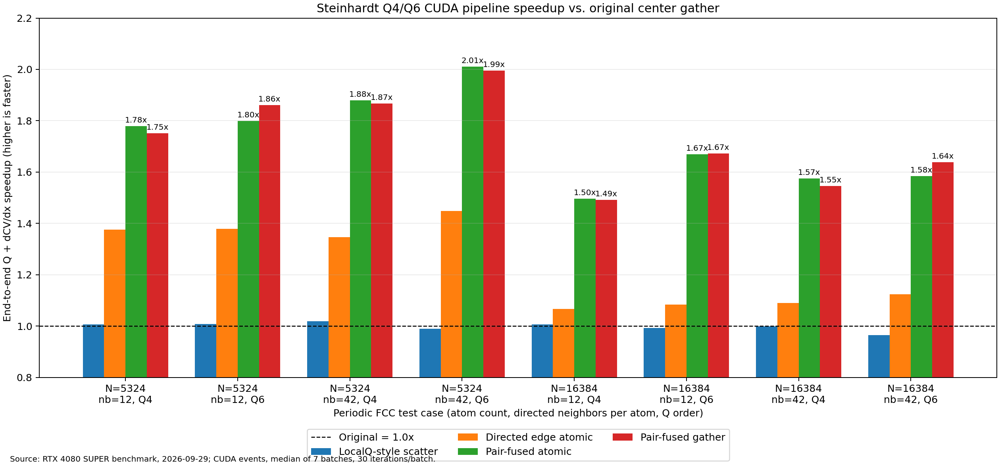

# Q4/Q6 GPU 布局测试结果

测试日期：2026-09-29  
GPU：NVIDIA GeForce RTX 4080 SUPER，compute capability 8.9  
CUDA：12.6，`nvcc -O3 -std=c++17 -arch=sm_89`  
计时：CUDA events；每个结果 30 次/批、7 批取中位数；正式计时前持续预热 GPU。

## 结论

普通 Q4/Q6 的前向计算没有必要仅为了速度改成 LocalQ 的两 kernel
结构。`localq_style` 与原始单 kernel 结构的端到端差异在 -1.8% 到
+3.6% 之间，基本是同一速度等级，而且多一次 kernel launch。

在本测试满足“全原子、双向对称邻接、L=4/6”的条件下，最佳结构是
half-list `pair_fused`：每个无向原子对只调用一次现有完整梯度 helper，
同时得到 q_i 与 q_j 对该 pair 的贡献。与原始流水线相比，完整 Q+导数
加速 1.50x–2.01x；单独的导数阶段加速 2.20x–3.56x。

`pair_fused_atomic` 和 `pair_fused_gather` 的耗时差异通常在几个百分点：

- `pair_fused_atomic` 实现更简单，多数场景略快；每个无向 pair 对两个
  端点各做 3 次 double atomic。
- `pair_fused_gather` 没有 atomic、结果规约顺序固定，更适合你希望减少
  AtomicAdd 并准备以后加入 per-atom virial 的方向；代价是 pair value
  缓冲区和 signed incidence CSR。

warp-per-center 不推荐。12 邻居时多数 lane 空闲；42 邻居时每中心占用
一个完整 warp，寄存器压力和邻居 atomic 竞争抵消了并行收益。

## 端到端 Q + dCV/dx 时间（ms）

| 原子数 | 平均邻居 | L | 原始 | LocalQ式+atomic | center Q + pair atomic | center Q + pair gather | 最佳加速 |
|---:|---:|---:|---:|---:|---:|---:|---:|
| 5324 | 12 | 4 | 0.513809 | 0.510839 | 0.288939 | 0.293513 | 1.78x |
| 5324 | 12 | 6 | 0.850159 | 0.842991 | 0.472410 | 0.456909 | 1.86x |
| 5324 | 42 | 4 | 1.781965 | 1.749129 | 0.948326 | 0.954607 | 1.88x |
| 5324 | 42 | 6 | 2.912154 | 2.943590 | 1.447765 | 1.459985 | 2.01x |
| 16384 | 12 | 4 | 1.015301 | 1.008981 | 0.678332 | 0.680380 | 1.50x |
| 16384 | 12 | 6 | 1.668301 | 1.679633 | 0.999424 | 0.997888 | 1.67x |
| 16384 | 42 | 4 | 3.605197 | 3.608542 | 2.289834 | 2.331853 | 1.57x |
| 16384 | 42 | 6 | 5.881071 | 6.091332 | 3.713434 | 3.589598 | 1.64x |

## 单独导数阶段

最佳 pair-fused 实现相对 `original_gather` 的加速如下：

| 原子数 | 平均邻居 | Q4 | Q6 |
|---:|---:|---:|---:|
| 5324 | 12 | 3.13x | 2.97x |
| 5324 | 42 | 3.56x | 3.49x |
| 16384 | 12 | 2.38x | 2.20x |
| 16384 | 42 | 2.21x | 2.29x |

普通 directed-edge 实现只比原始 gather 快约 10%–45%。half-list 的收益
更大，因为它不只是增加线程数，还把昂贵的三角函数和完整梯度 helper
调用次数从 directed E 降到 E/2。

## 正确性

- `localq_style` 和 `edge_parallel` 的 Q 值与原始 Q kernel 在本数据上逐位相同。
- 所有导数布局相对 `original_gather` 的最大绝对误差约 1e-19，最大相对
  误差约 2e-14；差异来自浮点规约顺序。
- 对每个 case 抽查 3 个原子、3 个方向，共 9 个坐标分量。解析导数与
  全局平均 Q 的中心有限差分最大相对误差为 7.5e-9–1.35e-6。
- 所有实现的三个总梯度分量均接近零，满足平移不变性。

## 适用范围和生产接入条件

这是调用项目真实 `CV_Steinhardt_math.h` 的独立 CUDA kernel benchmark，
并非完整 LAMMPS fix 的 wall-clock 测试。它使用周期 FCC 构型（加入小扰动）
和 CSR 邻接；不计分配、建邻居表、MPI、ghost 通信和主机拷贝。

导数计时有意隔离布局差异，未包含生产核当前的 `d_dYlm_dr` 每邻居全局
累加、per-atom virial 写入、group/mask 分支和全局 CV 标量规约。因此这些
数字用于选择结构，不能直接当作完整 MD step 的加速比。

pair-fused 直接成立需要邻接互易。如果 `cutoff_Natoms` 截断导致 i 选择 j
而 j 不选择 i，就不能直接把它压成 half-list。生产实现需要先保证 mutual
neighbor，或者把 mutual pairs 走 fused 路径、剩余 directed edges 走通用
source 路径。跨 MPI rank 的 pair 还需要唯一 owner 和 reverse communication。

对 per-atom virial，pair-fused 很合适：同一个 pair contribution 可以在计算
梯度时顺便形成 pair virial，再按 LAMMPS 约定分给两个端点。global virial
可从同一 pair 数据规约，不需要再次遍历导数数组。

## 建议实施顺序

1. 保留当前一线程一中心的 Q4/Q6 前向计算，不做 LocalQ 式拆核。
2. 先实现 half-list `pair_fused_atomic`，用于验证 LAMMPS/MPI 接入和 virial。
3. 若需要可重复规约、尽量消除 AtomicAdd，再换成
   `pair_fused_store + signed-incidence gather`；数学核保持不变。
4. 用真实液体/晶化轨迹和生产 group/ghost 分布再做一次集成 benchmark，
   同时记录完整 fix 时间，而不只记录 CUDA kernel 时间。
