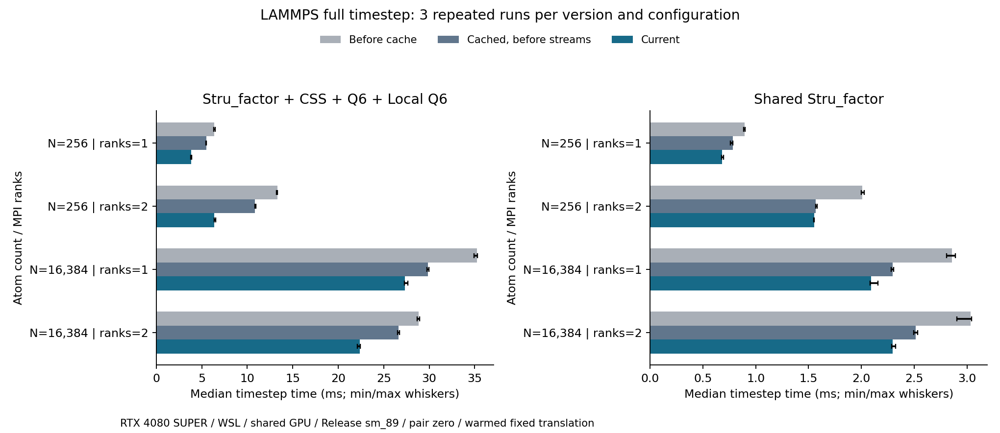
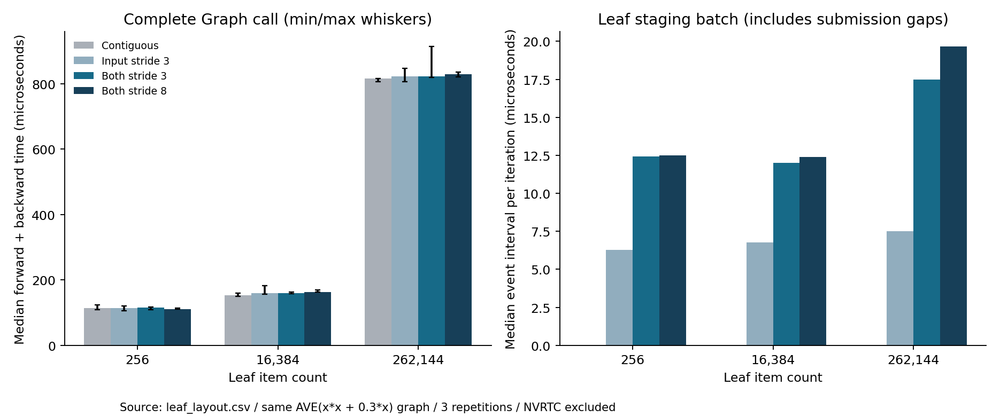

# 缓存与流改造性能记录 — 2026-10-22

本报告比较同一轮架构迁移中的**本地开发快照**。与实际上传提交 `2d9ac78` 的直接对照
见 [上传版本性能复测](UPLOADED_COMPARISON.md)：部分负载存在明显回退，不能把下面的
阶段优化收益解释成整个当前版本相对上传版都更快。

本机八个配置中，当前版相对缓存改造前的快照加速 **1.29～2.09 倍**；
相对已有缓存、尚未改流的快照加速 **1.01～1.71 倍**。缓存与流改造都有可测收益，
幅度随 CV 组合、体系规模及 MPI rank 数变化。

## 对照版本与环境

- **缓存前**：由 `build/metadata-cache-baseline` 的实现快照重建。
- **缓存后、改流前**：由 `build/streams-baseline` 的实现快照重建。
- **当前版**：包含环境/Graph 流、View 就绪钩子及重新装配的事件修复。

两个历史快照缺少根工程等文件。重建时先复制当前 `src/include/cmake/third_party`
与根 CMake，再用快照文件覆盖，保留快照实现；统一使用仓库 fmt 10.2.0、相同编译器、
Release `-O3 -DNDEBUG`、sm_89 及同一 LAMMPS/MPI。因此这里比较的是**本地快照重建版**，
不是声称复现了历史发布二进制。源码逐文件 hash、配置命令和插件 hash 位于
[baseline_manifest.json](results_20261022/baseline_manifest.json)。本地重建脚本为
`build/prepare-performance-baselines.py`。

| 版本 | 插件 SHA-256 |
|---|---|
| 缓存前 | `31abaf66925f64f2b660b93ac718945781a7cd54eb2ac689df93d1255784e1c1` |
| 缓存后、改流前 | `d46365ddcd32a803d6a1091b38be34018f777d5778d99d6120e8469a6a4ac2b2` |
| 当前版 | `422782f4c882451820e3b40c831fafc1e52cef74e747ce4956681e759548c66f` |

环境：RTX 4080 SUPER，驱动 610.88，CUDA 12.6.20，g++ 11.4，CMake 3.31.8；
Intel i7-14700KF，WSL2 分配 8 个逻辑 CPU。各进程 `OMP_NUM_THREADS=1`，
OpenMPI `--bind-to none`，所有 rank 共用 GPU0。机器与工具记录见
[environment.json](results_20261022/environment.json) 和 [metadata.json](results_20261022/metadata.json)。

## 完整 LAMMPS timestep

每个配置先验证数值，再预热 100 步；用当前版 200 步试跑选出各版共用的计时步数。
每个计时段实际为 2.913～10.597 秒，三次重复、随机化版本顺序，共 **72 个正式样本**。
NVRTC 编译在 setup 完成，单独记录为 21.47～30.21 ms（中位数 23.63 ms），
不计入以下 LAMMPS `Loop time`。

下面均为三次中位数，时间单位 **ms/步**；加速比 = 对照版耗时 / 当前版耗时。

| 负载 | 原子数 | ranks | 缓存前 | 缓存后、改流前 | 当前 | 相对缓存前 | 相对改流前 |
|---|---:|---:|---:|---:|---:|---:|---:|
| 共享 Stru_factor | 256 | 1 | 0.895 | 0.783 | 0.683 | 1.31× | 1.15× |
| 共享 Stru_factor | 256 | 2 | 2.010 | 1.569 | 1.552 | 1.30× | 1.01× |
| 共享 Stru_factor | 16384 | 1 | 2.856 | 2.298 | 2.092 | 1.37× | 1.10× |
| 共享 Stru_factor | 16384 | 2 | 3.031 | 2.515 | 2.294 | 1.32× | 1.10× |
| 混合 CV | 256 | 1 | 6.354 | 5.512 | 3.857 | 1.65× | 1.43× |
| 混合 CV | 256 | 2 | 13.293 | 10.844 | 6.360 | 2.09× | 1.71× |
| 混合 CV | 16384 | 1 | 35.243 | 29.876 | 27.329 | 1.29× | 1.09× |
| 混合 CV | 16384 | 2 | 28.856 | 26.637 | 22.362 | 1.29× | 1.19× |

共享负载为两个相同 group/cutoff 的 Stru_factor，图包含均值的积与和。
混合负载再加入三元素 CSS、Q6、Local Q6。两种负载均为两个图输出。
图中误差线是三次样本的最小/最大值，原始数据在 [summary.json](results_20261022/summary.json)
和 [results.json](results_20261022/results.json)。

缓存阶段单独带来约 **1.08～1.28 倍**加速。流相关改造在小体系混合 CV 中收益最大；
256 原子、双 rank 的共享 Stru_factor 仅有约 **1.1%** 的额外提升，工程收益很小。
大体系混合 CV 的计算量增大后，流阶段的相对收益下降，但仍减少约 2.55～4.28 ms/步。
这是整个流改造包的净收益，包含减少同步、事件依赖及调度变化；本次没有 GPU 时间线，
不能进一步将它拆成各机制的独立收益。

同一 GPU 上 rank 数也不是越多越快：当前版 256 原子共享负载从 0.683 增至 1.552 ms/步；
而 16384 原子的混合负载从 27.329 降至 22.362 ms/步。应按实际负载选 rank 数。

## 数值核对与适用范围

- 24 组初始版本/配置检查均通过：坐标及 CV/偏势差为零，最大逐原子力差
  `5.42e-19`，最大压力差 `2.84e-14`，且偏置力非零。
- 72 次长计时结束后的 CV/偏势差为零，最大压力差 `5.68e-14`。
  记录见 [validation.json](results_20261022/validation.json) 与
  [final_validation.json](results_20261022/final_validation.json)。
- 每次输入、日志和验证原子 dump 在本机 `build/performance/comparison/`；归档 JSON
  保留完整原始样本、NVRTC 时间、步数、LAMMPS 阶段计时和插件 hash。

使用 `pair_style zero` 和固定平移轨迹，侧重增强采样链条；固定组与较少的邻居重建
使缓存命中率高。这些数字不能直接当作生产势函数、频繁组变化或高频邻居重建下
整个 MD 的加速比。LAMMPS 的 Modify 占主循环 96.02～99.73%，其中也包含 Fix 内部的
MPI 通信，不能把外层 Comm 列看成 CV 的全部通信时间。WSL/共享 GPU 的样本波动也需保留。

## Leaf 非连续暂存成本

当前版，单 Leaf 的 `AVE(x*x+0.3*x)` 图。每种布局预热 50 次，计时 2000 次前向/反向，
重复三轮并打乱布局顺序；值、梯度及 padding 全部核对通过。

以下为**完整 Graph 前向＋反向**的中位数，单位 µs/次；包含传输及 Host 规约。

| 项数 | 连续 | 仅输入 stride=3 | 值/梯度 stride=3 | 值/梯度 stride=8 |
|---:|---:|---:|---:|---:|
| 256 | 113.20 | 113.13 | 115.86 | 111.35 |
| 16384 | 153.13 | 158.82 | 160.13 | 163.47 |
| 262144 | 815.75 | 822.04 | 822.01 | 828.13 |

单独测 Leaf 适配批次，输入 gather 约 6.3～7.5 µs/次，gather＋scatter 约
12.0～19.7 µs/次。CUDA event 区间包含 Host 提交间隙，因此不是纯 kernel 独占耗时，
也不能简单加到上表去预测收益。

16384 项时，值/梯度 stride=3 的完整调用中位数比连续布局高约 4.6%，stride=8 高约 6.8%。
小体系及大体系的部分样本区间重叠，个别非连续布局的中位数甚至略低于连续布局；
这反映测量波动，不能解释为拷贝能提高速度。完整样本见
[leaf_layout.csv](results_20261022/leaf_layout.csv) 和 [leaf_summary.json](results_20261022/leaf_summary.json)。

**本轮建议：保留缓存与流改造，暂不推进 stride codegen 特化。** 当前 LAMMPS 桥接
先装配到连续 Leaf，这条主链没有上述额外 gather/scatter。待 GPUMD/Kokkos 真实数组
接入后，再用实际 Leaf 数量、stride 与形状复测。直接 stride kernel 的访存模式也会改变，
当前暂存开销不能视为特化后必然能全部收回的收益。

该建议限定在上述开发快照之间；整个架构迁移的净代价需要结合上传版本复测判断。

## 运行入口

可复现命令和测量方法见 [README](README.md)。本轮还完成：CUDA 预设默认 `native`，
预设最低 CMake 3.24；native 构建的独立 CTest **26/26** 通过，另在全新 Release/native
目录构建并运行了装配测试及 Leaf 布局基准。Graph kernel 的连续数组 ABI 边界已写入
[ENGINE_ADAPTER.md](../graph/ENGINE_ADAPTER.md)。
