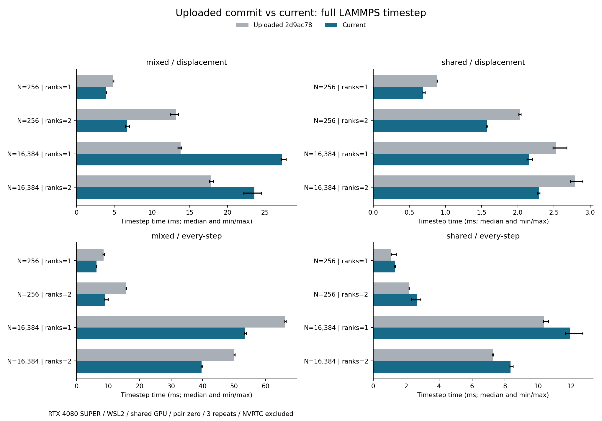

# 与上传版本的直接性能对照 — 2026-10-22

**当前版本并非全面快于上次上传版。** 普通邻居重建条件下，八组配置中六组更快，
但大体系 mixed 在单/双 rank 下耗时分别增加约 97.2%/32.6%。每步重建时，
共享 Stru_factor 耗时增加约 14%～22%，mixed 则减少约 19%～42%。

此前 [缓存与流改造记录](RESULTS.md) 比较的是迁移过程中的开发快照；其阶段收益
不能代替这里对整个上传版本的比较。本次找到的主要回退是 Local Q 的 ghost 环境补全路径。

## 对照版本、条件与范围

- 上次上传：远端 `main` 核对为 `2d9ac7801ed7f093d5e83312f707e2167a337595`。
  从该提交完整导出，367 个文件逐一核对 Git blob，源码未修改，使用原提交的 CMake 重建。
- 当前版：与前一轮一致的冻结插件。两个版本使用相同 LAMMPS/MPI、CUDA 12.6、GCC 11.4、
  Release `-O3 -DNDEBUG` 和 sm_89。上传版保留原构建设置中的 `--generate-line-info`。
- 上传插件 SHA-256：`67b9ca52375508986a734af1de767f1d9bbc779df42e0b73a8fa1f1db17b1ef2`。
- 当前插件 SHA-256：`422782f4c882451820e3b40c831fafc1e52cef74e747ce4956681e759548c66f`。
- 硬件为同一台 WSL2、RTX 4080 SUPER、i7-14700KF；WSL 分配 8 个逻辑 CPU。
  `OMP_NUM_THREADS=1`，OpenMPI `--bind-to none`，所有 rank 共用 GPU0。
- 256/16384 原子、1/2 个 MPI rank、shared/mixed 两种负载，另外拆分 CSS/Q6/Local Q6。
  mixed = 两个 Stru_factor + CSS + Q6 + Local Q6；图有两个输出。
- 使用 `pair_style zero` 和固定平移，初始沉积后扰动，保证偏置力非零。
  预热 100 步，NVRTC setup 不计入 Loop time；每项三次、随机化版本顺序。
  共 **120 次计时**，单次计时段 1.666～19.964 秒。

这里测的是同一硬件上的不同运行条件。尚未测不同 GPU、原生 Linux、跨节点/多 GPU、
GPUMD/Kokkos 生产接入、真实势函数和动态原子组下的速度；不能据此给出跨平台加速结论。

基线构建命令与提交验证见 [baseline_provenance.json](uploaded_20261022/baseline_provenance.json)，
硬件信息见 [environment.json](uploaded_20261022/environment.json)。全部表格取三次中位数，
**耗时变化为正表示变慢，为负表示变快**。

## 按位移触发邻居重建

默认 `pair zero 4.0`，`neigh_modify every 1 delay 0 check yes`。
各计时段 LAMMPS 报告 0～2 次原生邻居表重建。

| 负载 | 原子数 | ranks | 上传版 ms/步 | 当前 ms/步 | 当前耗时变化 |
|---|---:|---:|---:|---:|---:|
| 共享 Stru_factor | 256 | 1 | 0.889 | 0.688 | -22.6% |
| 共享 Stru_factor | 256 | 2 | 2.034 | 1.571 | -22.8% |
| 共享 Stru_factor | 16384 | 1 | 2.530 | 2.158 | -14.7% |
| 共享 Stru_factor | 16384 | 2 | 2.794 | 2.294 | -17.9% |
| 混合 CV | 256 | 1 | 4.878 | 3.944 | -19.1% |
| 混合 CV | 256 | 2 | 13.162 | 6.729 | -48.9% |
| 混合 CV | 16384 | 1 | 13.811 | 27.241 | +97.2% |
| 混合 CV | 16384 | 2 | 17.795 | 23.599 | +32.6% |

## 每一步都重建邻居表

`neigh_modify every 1 delay 0 check no`；48 个样本均核对到
`Neighbor list builds == measured steps`，实际覆盖了强制重建条件。

| 负载 | 原子数 | ranks | 上传版 ms/步 | 当前 ms/步 | 当前耗时变化 |
|---|---:|---:|---:|---:|---:|
| 共享 Stru_factor | 256 | 1 | 1.102 | 1.335 | +21.1% |
| 共享 Stru_factor | 256 | 2 | 2.179 | 2.660 | +22.1% |
| 共享 Stru_factor | 16384 | 1 | 10.378 | 11.932 | +15.0% |
| 共享 Stru_factor | 16384 | 2 | 7.276 | 8.328 | +14.4% |
| 混合 CV | 256 | 1 | 8.547 | 6.370 | -25.5% |
| 混合 CV | 256 | 2 | 15.721 | 9.056 | -42.4% |
| 混合 CV | 16384 | 1 | 66.332 | 53.520 | -19.3% |
| 混合 CV | 16384 | 2 | 50.033 | 39.689 | -20.7% |

注意：LAMMPS 的原生邻居重建次数与适配器内部补表次数是两个指标。
Local Q 的补表可以在原生邻居表没有重建的步上发生。

## 大体系混合负载的回退定位

先拆为独立 CV，仍为 16384 原子、单 rank、pair cutoff 4.0、按位移重建：

| 负载 | 原子数 | ranks | 上传版 ms/步 | 当前 ms/步 | 当前耗时变化 |
|---|---:|---:|---:|---:|---:|
| CSS | 16384 | 1 | 1.890 | 1.506 | -20.3% |
| Local Q6 | 16384 | 1 | 5.805 | 22.150 | +281.6% |
| Q6 | 16384 | 1 | 3.828 | 3.294 | -14.0% |

CSS 和 Q6 各自改善；Local Q6 从 5.805 增至 22.150 ms/步，耗时约为上传版的 3.82 倍。
各独立图的偏置种子和共享开销与 mixed 有区别，因此不能直接相加预测 mixed 耗时。

随后保持 CV、初态和图不变，将测试用底层 `pair zero` cutoff 从 4.0 扩为 5.0：

| mixed，16384 原子，单 rank | 上传版 ms/步 | 当前 ms/步 |
|---|---:|---:|
| pair cutoff 4.0 | 13.811 | 27.241 |
| pair cutoff 5.0 | 14.057 | 11.110 |

该变化只用于控制邻居覆盖范围；真实势函数的 cutoff 应由物理模型决定。
两种 cutoff 的初始 CV、偏势、力和压力已作交叉验证。对照仍包含原生 pair 邻居表规模变化的影响。

复用现有 `engine_cache_stats` 探针，对当前版 Local Q6 连续五步读取适配器计数：

| pair cutoff | 坐标上传次数 | 邻居准备重建次数 | 邻居 CSR 上传次数 |
|---|---:|---:|---:|
| 4.0 | 5 | 5 | 4 |
| 5.0 | 5 | 0 | 0 |

该 CV 的 FERMI 有效半径约 4.239，候选半径再包含 skin。
源码 [prepare_neighbors](../../src/core/zqc_lammps_engine.cu) 中，`geometry_rows` 会使
每次 evaluation 进入补表分支，重新建立空间单元、修补 ghost 行、组装和比较 CSR。
候选行顺序或内容变化还会引起再次上传。单 CV 实测、cutoff 对照和计数器结果共同支持：
**这条 ghost 补表路径是当前大体系 mixed 回退的主要来源。**

源码只读复核也将该路径列为首要候选；其他关于 virial、Host 往返的猜测没有单独做
消融测量。这里没有 GPU/CPU 时间线，无法将每一毫秒严格分摊到各函数。

计数器数据见 [cache_probe/results.json](uploaded_20261022/cache_probe/results.json)，
含探针源码、编译命令及输入。诊断探针的 Python/MPI 启动曾报告 shared-memory BTL
初始化警告，进程正常返回、计数读取成功；120 次正式计时的进程日志均无此警告。

## 数值与归档

- 40 组初始版本核对通过，120 次计时终态核对通过。
- CV/偏势差为零；最大力差 `5.421e-19`，最大压力差 `5.684e-14`。
- 另有 4 组跨重建条件/cutoff 检查通过。每步重建会将坐标 wrap 回主盒，跨条件坐标
  按固定正交盒的最小镜像比较，误差为零；力和 CV 直接比较。
- 数值验证范围是本次固定 FCC 扰动夹具，不能替代其他构型下的正确性测试。
- 原始样本、范围、NVRTC 时间、完整重建次数和入口源码快照保存在
  [普通条件](uploaded_20261022/displacement/)、[每步重建](uploaded_20261022/every-step/)、
  [单 CV](uploaded_20261022/isolated/single_cvs/)、[pair cutoff 5](uploaded_20261022/wide_pair/pair5/)。
  汇总核对见 [validation_summary.json](uploaded_20261022/validation_summary.json)。

## 接下来的优化重点

优先改善 Local Q ghost 候选行的复用和失效策略，保留完整邻居环境的正确性要求；
随后单独测每步重建时共享 Stru_factor 的 Host 组装/上传成本。
当前测量支持保留已经验证的缓存与流优化，但整个架构迁移仍有需要处理的性能回退。

运行入口和新增参数见 [README](README.md)。此次只增加性能测量和记录，生产源码未修改。
