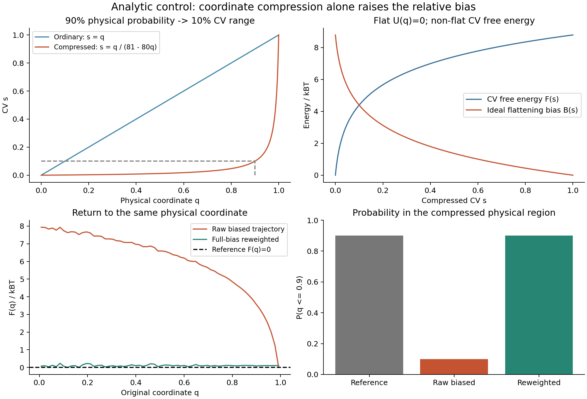
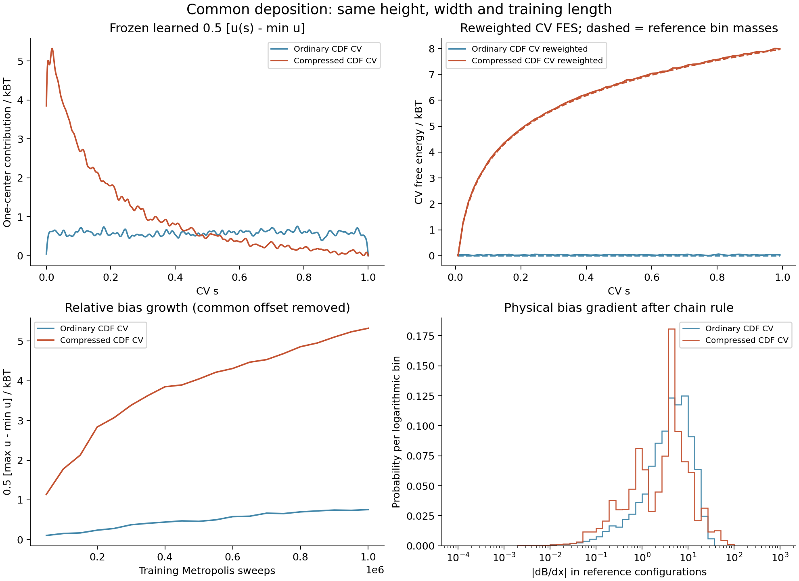
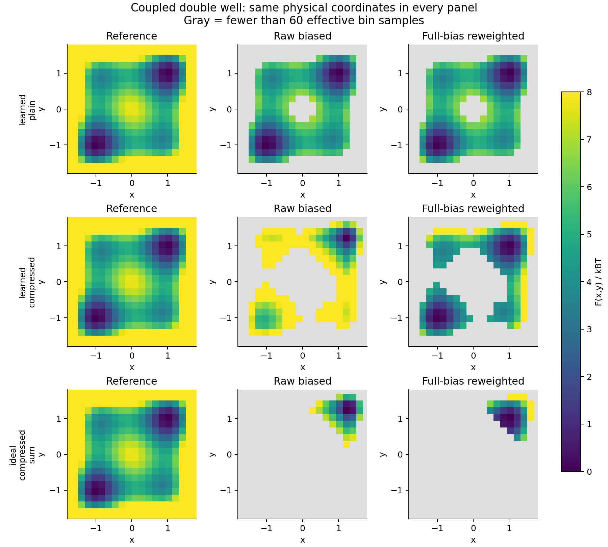

# CV 压缩、共同沉积与 FES：310 实测

2026-10-28，在 310_right（excelsior）直接运行。新增文件均为独立 benchmark；
本次验证使用平衡 Metropolis 构型采样，sweep 不代表 MD 时间。

## 结论

将大量概率压进很窄的 CV 区间，确实可以形成较高的相对偏势，即使原势能完全平坦。
变换后的 CV 自由能包含坐标概率密度的变化，因此偏势高度不能直接与原势能高度比较。

精确的冻结偏势重加权关系仍成立，但有限样本会失效。本轮共同沉积的压缩 MEAN
在 384 万帧后仍未达到 FES 覆盖门槛；更强的 SUM 在 96 万帧中仅约 397 个权重有效样本。
这些失败保留在结果中。单独一条 CV 的 FES 看起来接近参考，并不能证明联合 FES 已恢复。

## 解析控制：原势能为零

物理坐标 q 在 [0,1] 上均匀分布，U(q)=0。采用光滑可逆变换：

    s = q / (81 - 80q)
    q = 81s / (1 + 80s)
    g(0.9) = 0.1
    p0(s) = 81 / (1 + 80s)^2

因此精确地有 P(s≤0.1)=0.9。取 kBT=1，并分别把曲线最低值移至零：

    F(s) = 2 log(1 + 80s)
    B(s) = 2 log[81 / (1 + 80s)]
    B(q) = 2 log(81 - 80q)

B 的最大相对高度为 8.78890 kBT，而 U(q) 始终为零。
这里的点密度极值比为 6561，故范围为 log(6561)。
此前讨论的 log(81)=4.39445 对应两个区间的平均密度比；
仅凭“90% 压到 10%”不能确定区间内部形状或点值的最大偏势。

从均匀 s 独立抽样，再逆变换到 q，相当于精确抽取这个冻结偏势下的平衡分布。
8 批各 10 万帧，使用 exp(B) 重加权：

| 量 | 结果 |
| --- | ---: |
| 无偏参考 P(q≤0.9) | 90% |
| 偏置后直接统计 | 10.0116% |
| 全偏势重加权 | 90.0071% |
| 独立批次标准误差 | 0.0781 个百分点 |
| 权重 ESS | 29,209.7 / 800,000 |

## 双阱与实际共同沉积

物理模型保持一致：

    U(x,y) = 4[(x²-1)²+(y²-1)²] + (x-y)²
    B(x,y) = a [u(s(x)) + u(s(y))]
    a = 1/2 (MEAN) 或 1 (SUM)

区间为 [-3,3]²，kBT=1，x、y 有相关性。先用独立积分获得无偏边缘 CDF Q(x)。
普通测试 CV 为 Q(x)，压缩测试 CV 为 Q(x)/(81-80Q(x))。
这样两组只改变坐标压缩，且被压缩的区域严格对应无偏概率 90%。
CDF 使用已知参考构造，是控制变量实验，不是建议生产计算预先知道真实分布。

两组均训练 100 万 sweeps，每 200 sweeps 两个中心各沉积一个 height=0.02、sigma=0.005 的 hill，
共 10,000 hills；同一条 u(s) 以 MEAN 进入训练能量。
冻结最终表后重新预热 20,000 sweeps，再运行 8 条独立链；每 8 sweeps 保留一帧，包括拒绝移动。
相同 CV 单位下的 sigma 对应不同物理分辨率，因此不能把这组参数称为两种映射下的最优参数。

共同沉积后的单中心贡献 0.5[max u − min u]：

| CV | 相对高度 |
| --- | ---: |
| 普通 CDF CV | 0.75547 kBT |
| 压缩 CDF CV | 5.32144 kBT |

另外测试解析控制中的 u(s)=2 log[81/(1+80s)]，分别作为相关双阱的 MEAN 和 SUM 固定偏势。
“解析形状”只描述该函数的来源；在相关双阱中，共享单体函数不保证每个 CV 被拉平。

## 统计结果与未达标项

所有统计判据沿用 probability.py，在运行前固定：
矩最大误差 <0.035，独立链 SEM <0.010，误差 <4 SEM+0.003，
联合总变差 <0.035，覆盖区域 FES RMSE <0.12 kBT，
且 bin 权重 ESS≥60 的区域覆盖至少 98% 无偏参考概率。

初轮各 96 万帧。只将两组压缩 MEAN 延长四倍；
同种子、同表、同链的原始前缀已逐位核对一致。

| 最终组别 | 保留帧 | 权重 ESS | 参考概率覆盖 | FES RMSE / kBT | 结论 |
| --- | ---: | ---: | ---: | ---: | --- |
| 无偏 | 960,000 | 960,000 | 99.8858% | 0.02376 | 通过 |
| 普通 CV，共同沉积 MEAN | 960,000 | 950,104 | 99.8755% | 0.01624 | 通过 |
| 压缩 CV，共同沉积 MEAN | 3,840,000 | 140,791 | 97.3910% | 0.04041 | 覆盖未达标 |
| 压缩 CV，解析形状 MEAN | 3,840,000 | 388,272 | 99.6490% | 0.02481 | 通过 |
| 压缩 CV，解析形状 SUM | 960,000 | 397 | 39.7513% | 0.04375 | 多项未达标 |

RMSE 只在有效覆盖区域计算。最后一行的 RMSE 小，并不表示恢复良好：
它丢失了大部分参考概率区域。该组联合总变差为 0.25486；
P(x>0) 应为 0.5，却估为 0.61996，独立链 SEM 约 0.08167。

压缩共同沉积 MEAN 初轮覆盖 92.2753%，四倍长度后 97.3910%，仍未达标。
该组被压缩区域的概率由偏置后的 17.0258%，重加权为 90.2402% ±0.1994 个百分点（1 SEM）；
总体区域概率接近参考，但不足以验证整个联合面。

权重 ESS=(sum w)²/sum(w²) 未校正时间自相关；
独立链 SEM 另外检查链间统计波动，不能用权重 ESS 代替独立样本数。

二维图每一行使用相同原坐标 x、y；左为无偏参考，中为偏置后的直接统计，
右为全偏势重加权。灰色表示 bin 权重 ESS<60。
色标统一为 0–8 kBT，每幅曲线/曲面允许独立加常数。

## 实现与数值交叉检查

- 生产 HillBias 保存共同沉积历史。采样采用独立基准中的均匀三次 Hermite 表，
  每个 hill 更新表值与导数；最终与 HillBias 在 1003 个探针点核对。
  最大能量插值误差 1.24e-7，CV 导数误差 0.002732。
- HILLS 重新载入后，1003 个探针的能量和导数逐位相同。
- 生产 CUDA FrozenSharedBias 的 MEAN 在每组 256 对坐标上与 CPU 表核对：
  能量误差 ≤3.56e-15，映射链式法则后的物理导数误差 ≤1.74e-12；
  物理坐标有限差分误差 ≤1.16e-6（步长 2e-7）。
  SUM 是统计原型中对 MEAN 的整体倍乘，尚不是新增生产模式。
- 无偏积分 16/24 阶单元概率最大差 2.78e-17。
  偏置后的窄结构采用分块自适应积分至 64–512 阶，比较相邻阶数至误差 <2e-7。
  最强 SUM 的直接采样与其正确偏置平衡分布的总变差为 0.00220，
  而重加权回无偏分布的总变差为 0.25486。这支持“偏置后无偏重要区域样本太少”的解释。
- CLI 对压缩共同沉积的一条 48 万帧链执行 static-bias 重加权，
  输出 bin 概率与独立 NumPy 实现最大差 3.93e-15。

使用全部 B(x,y) 重加权；只取某一个中心 u(s) 会漏掉相关环境的偏置。
本轮测试验证冻结平衡分布，不验证在线沉积的时间依赖权重、成核速率或 Al3Sc 实际轨迹。

## 复现与产物

CMake 新增 zqc_shared_compression_probe，仅供此测试显式调用。
编译与采样在 310 直接运行，保持已有 A100 生产作业不变。
Python 3.10、NumPy 1.23.4、Matplotlib 3.6.2，OPENBLAS_NUM_THREADS=1、OMP_NUM_THREADS=1。

在仓库构建完成后：

    cmake --build build/graph-tests --target zqc_shared_compression_probe zqc_shared_probability_cuda -j 2
    python benchmarks/shared_frozen/compression.py \
      --library build/graph-tests/benchmarks/graph/libzqc_shared_compression_probe.so \
      --cuda-library build/graph-tests/benchmarks/graph/libzqc_shared_probability_cuda.so \
      --output build/compression-initial
    python benchmarks/shared_frozen/compression.py \
      --library build/graph-tests/benchmarks/graph/libzqc_shared_compression_probe.so \
      --cuda-library build/graph-tests/benchmarks/graph/libzqc_shared_probability_cuda.so \
      --samples 480000 --extend-from build/compression-initial \
      --output build/compression-extended

输出目录必须尚不存在。延长模式保留另外三组的初轮帧，并核对两组延长链的前缀。

310 根目录：

    /home/saitang/work/MetadToy-shared-probability-20261028

run-compression 保存初轮原始链、HILLS、表与图；
run-compression-extended-v2 保存延长结果。
run-compression-extended 是附加偏置参考积分分辨率不足时中止的中间目录；
提高积分分辨率后重新分析，统计判据未变。
compression310.sh 与 compression_extend310.sh 保存执行参数；
后者执行时仅将输出目录替换为 run-compression-extended-v2。
正式采样/分析脚本初轮约 44 秒，延长与额外参考积分约 99.5 秒；这不是 MD 运行性能指标。

仓库保留 initial.json、extended.json、学习表、沉积进度和三张图。
完整原始链位于 310；JSON 记录源码、编译库和表的 SHA256。

对真实 CV 的下一步应优先统计无偏/弱偏轨迹中的分布、导数尺度和重加权有效样本，
再决定映射、hill 宽度和偏势强度；当前测试不能给出通用安全幅度。

冻结概率之后的 [Langevin MD](KINETICS.md) 与 [同表配对](MATCHED_MD.md)显示：
当前压缩参数不能保证双向动力学加速；保留反向减慢及粗步长失败记录。
