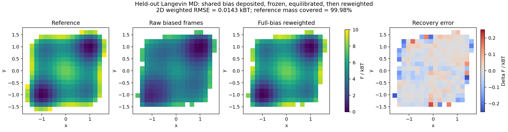
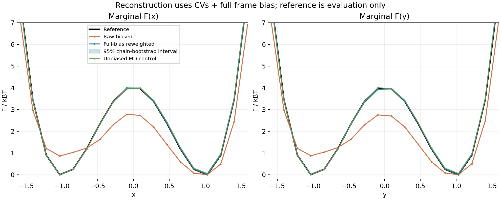

# 简单模型的共享偏势沉积、冻结与 FES 复原

2026-10-28，在 310（excelsior）直接运行。改动限定在 benchmark 与文档。

**结论：本次耦合双阱模型中，完整总偏势重加权通过预设的 FES、覆盖、矩和精度门槛。**
二维 FES 的参考概率加权 RMSE 从原始带偏轨迹的 0.68991 kBT 降为 0.01432 kBT。
该结论针对本次固定偏势的平衡采样；Al3Sc 及强压缩 CV 尚需各自验证。

## 测试流程

模型使用两个位置坐标及其速度：

\[
U(x,y)=4[(x^2-1)^2+(y^2-1)^2]+(x-y)^2,\quad
k_BT=m=\gamma=1.
\]

两个坐标有耦合，检验二维联合分布可以发现仅检查边缘分布时漏掉的相关性错误。
CV 直接取 x、y，共用一张一维表：

\[
B(x,y)=\frac{u(x)+u(y)}2.
\]

1. 从空表开始运行欠阻尼 Langevin BAOAB 积分，步长 0.0005。
   每 0.5 个约化时间单位，每个坐标各沉积一个高斯，height=0.02、sigma=0.12。
   固定沉积时长 200，共 800 个 hill；种子在测试前固定为 187210。
2. 冻结表，用新种子从四个坐标象限各启动四条轨迹，共 16 条。
   初始速度服从 Maxwell 分布；每条先运行 500 时间单位重新平衡，这一段丢弃。
3. 每条继续运行固定 10000 时间单位，每 0.1 记录一帧，共 160 万帧。
   记录 x、y、实际施加的完整 B、速度平方及最近进入的稳定核心。
4. 用独立程序重建 FES，输入仅为记录的 CV、B 和 kBT。
   完整数据另外通过现有 metadtoy CLI 的 static-bias 路径。
5. 重建完成后，另一阶段对已知 U 做 Gauss–Legendre 数值积分，作为误差评估答案。
   另跑 16 条相同时长的无偏 MD，作采样预算对照。

本次没有用真实分布构造 CDF，也没有预设某一区域的概率占比。
旧的沉积 ABI 仍接受一个映射文件参数，物理坐标模式忽略它；本次传入零表。
新增的冻结采样接口直接使用物理坐标，不读取映射文件。

已知 U 用来产生模型的动力学力；真实 FES/边缘概率只在最后评估阶段计算。
首次到达即停止的轨迹以及在线沉积段均未混入平衡 FES 数据。

## 重建公式

冻结偏势并达到平衡后，使用每帧的完整偏势：

\[
w_t=\exp[B(x_t,y_t)/k_BT],\qquad
\hat p_{ij}=\frac{\sum_t w_t\,1_{(x_t,y_t)\in\text{bin}_{ij}}}{\sum_t w_t},
\quad F_{ij}=-k_BT\log\hat p_{ij}+C.
\]

实现先减去 log weight 的最大值，保证指数求值稳定。此例中的 B 包括两个中心及 MEAN 的 1/2；
单个中心的 u(x) 不等于整帧偏势。重建不需要把共享表的负值当作 FES。

这里采用均匀网格，单元面积引入的项可以吸收到 C 中。
参考概率在每个同样的网格单元内积分，避免拿点值密度与单元概率直接比较。

静态重加权公式参考 [PLUMED REWEIGHT_BIAS](https://www.plumed.org/doc-v2.10/user-doc/html/_r_e_w_e_i_g_h_t__b_i_a_s.html)。

## 结果

| 指标 | 原始带偏轨迹 | 完整 B 重加权 | 无偏 MD 对照 |
|---|---:|---:|---:|
| 二维 FES RMSE / kBT | 0.68991 | **0.01432** | 0.03478 |
| 一维 F(x) RMSE / kBT | 0.55711 | **0.00584** | 0.02834 |
| 一维 F(y) RMSE / kBT | 0.55878 | **0.00800** | 0.02758 |
| 达到单元 weight ESS 门槛的参考概率质量 | 99.9787% | **99.9773%** | 99.9295% |
| 联合概率总变差距离 | 0.26833 | **0.00478** | 0.01559 |
| P(x>0)，真实值为 0.5 | 0.66967 | **0.49804** | 0.48614 |
| P(x>0) 的 95% 独立轨迹 bootstrap 区间 | [0.66035, 0.67983] | **[0.48696, 0.51038]** | [0.45243, 0.51638] |
| P(x>0) 独立轨迹 SEM | 0.00506 | **0.00607** | 0.01715 |
| 核心间跃迁次数 | 3334 | 同一轨迹的 3334 | 844 |
| 全部门槛 | 未通过分布准确性 | **通过** | 未通过独立轨迹精度 |

二维图展示参考 FES、原始带偏分布、重加权结果及对齐常数后的误差：

一维图黑线是参考，橙线为原始带偏轨迹，蓝线与阴影是重加权结果及 95% 区间，绿线为无偏 MD：

原始带偏分布明显向右侧倾斜，重加权后恢复两侧相等的权重。
一次确定种子、确定时长的结果也有偶然误差；独立轨迹区间比单一 RMSE 更能反映这一点。

## 门槛和不确定度

运行前写入 protocol.json 的主判据：

- 32×32 网格，范围 [-3,3]²；用于 FES 误差的单元要求 weight ESS≥60。
- 这些单元覆盖至少 98% 的参考概率质量。
- 二维 FES 参考概率加权 RMSE<0.12 kBT，联合分布总变差距离<0.035。
- 六个矩的最大绝对误差<0.035，独立轨迹 SEM<0.010。
- 每个矩的误差<4 SEM+0.003。
- 动能温度偏离 1 不超过 4 SEM+0.003。

六个矩为 P(x>0)、P(y>0)、P(xy>0)、〈xy〉、〈x²〉、〈y²〉。
FES 对齐一个加性常数后计算 RMSE；高自由能尾部的极低概率网格不保证相同精度。
图中的空白表示超出展示能量范围或未达到样本门槛的网格。

整条轨迹作为 bootstrap 单位，重抽样 2000 次。SEM 使用独立轨迹的加权比值影响量；
没有把相邻 MD 帧当作独立样本。weight ESS 约 968023/1600000，
仅反映权重集中程度，**不是去除时间自相关后的独立样本数**。

重加权前半段 P(x>0)=0.48719，后半段=0.50901；全程估计=0.49804。
有限采样仍存在分段波动。无偏对照的 SEM 为 0.01715，未达到 0.010 门槛，
因此不能把“无偏平均曲线也很接近”写成无偏组全部通过。

冻结偏势使本例的跨阱采样次数约为无偏组的 3.95 倍。
这是被修改的动力学中的采样效率指标，不能拿来恢复原始体系的速率常数。
本次也没有验证所有沉积种子或强压缩映射下均有该收益。

## 实现核对

- 与生产 HillBias 高斯直接求值相比：表能量最大误差 4.52e-11，CV 导数误差 9.45e-8。
- 总力有限差分最大误差 6.27e-8。
- 新采样接口的 burn-in 是同一随机路径的连续积分；分段记录与完整路径的对应尾段逐位一致。
- 冻结前后的表 SHA256 相同：
  c0afb4a04e9e9b1deb9a7dd5d27959cd881748656715ec5399c2d4b1879ceda2。
- 160 万帧通过 CLI static-bias 重建，单元概率与独立实现的最大差为 3.48e-15。
- 实际 CUDA FrozenSharedBias 与本次采样插值器对照 512 对输入：
  能量误差 3.26e-14，导数误差 1.44e-13；中心置换误差 0，
  CUDA 能量有限差分误差 6.30e-10。
- 参考单元积分 8 点/16 点阶数比较通过 1e-10 门槛。
- 只新增 benchmark 的固定时长采样入口；生产 CV、Graph 和 MD 适配器未改动。

310 的四个 CPU worker 完成沉积及两组采样共约 29.6 秒；
这是该二维模型的批次计时，不代表 LAMMPS/GPUMD 生产体系性能。

## 复现

仓库内文件：

- fes_recovery_sample.py：沉积、冻结、重新平衡和固定时长采样。
- kinetics_probe.cpp：BAOAB 积分及新增 kinetics_fes_sample 接口。
- fes_recovery.py：分开的 reconstruct/evaluate 阶段；主重建判据不通过时返回非零状态。
- fes_recovery_cuda.py：实际 CUDA 表能量、导数与有限差分核对。
- results/fes_recovery_20261028/：摘要、门槛、图、CLI 网格、HILLS 和沉积表。

沿用 benchmarks/graph 下的 zqc_shared_kinetics_probe 目标和已配置的 build：

~~~bash
cmake --build build --target zqc_shared_kinetics_probe -j4
export OPENBLAS_NUM_THREADS=1 OMP_NUM_THREADS=1

python benchmarks/shared_frozen/fes_recovery_sample.py \
  --library build/benchmarks/graph/libzqc_shared_kinetics_probe.so \
  --output build/fes-recovery --replicas 16 \
  --duration 10000 --burn 500 --step 0.0005 --workers 4

python benchmarks/shared_frozen/fes_recovery.py reconstruct \
  --directory build/fes-recovery
python benchmarks/shared_frozen/fes_recovery.py evaluate \
  --directory build/fes-recovery
~~~

Python 环境需要 NumPy、Matplotlib，以及项目 tools/metadtoy_cli 的依赖。
输出目录必须为新目录，避免覆盖已有轨迹。
CUDA 核对另需编译 zqc_shared_probability_cuda 目标，然后：

~~~bash
python benchmarks/shared_frozen/fes_recovery_cuda.py \
  --kinetics-library build/benchmarks/graph/libzqc_shared_kinetics_probe.so \
  --cuda-library build/benchmarks/graph/libzqc_shared_probability_cuda.so \
  --directory build/fes-recovery
~~~

本次 310 完整原始数据保留于：

~~~
/home/saitang/work/MetadToy-shared-probability-20261028/run-fes-recovery
~~~

每条轨迹的 replica_*.npz 含 samples 和 diagnostics；
production.csv 包含供 CLI 读取的 x,y,bias 三列。统计摘要无需原始大文件即可回查。
