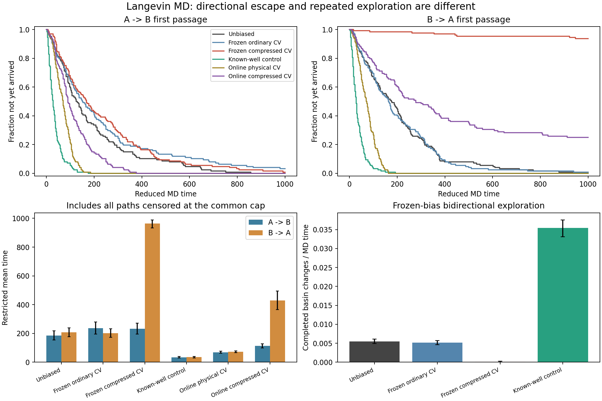
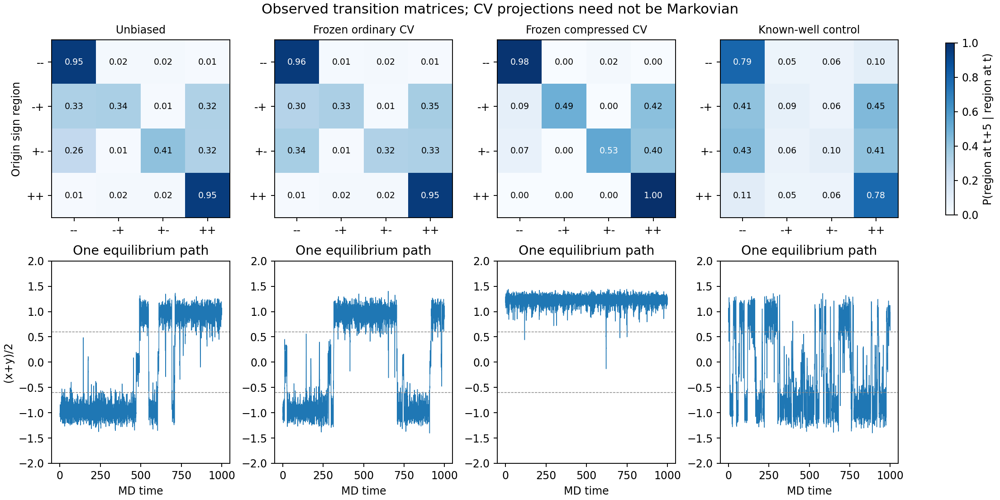

# Langevin MD：共享偏势的转移概率与实际加速验证

本页旧冻结组采用独立 Metropolis 训练表，不能用于隔离“冻结/继续更新”的影响。
同一 CV、同一 MD 训练表、同一验证初态的严格配对结果见 [MATCHED_MD.md](MATCHED_MD.md)。

2026-10-28，310_right（excelsior），直接运行，4 个 CPU 工作线程。
本轮新增独立两自由度 Langevin MD 原型，验证动力学加速。
它不是 Al3Sc/MEAM 的实测成核速率，也没有用平衡重加权系数恢复物理时间。

## 为什么需要这轮验证

此前的 Metropolis 本身是马尔科夫链，但转移由任意选择的提议分布决定；
其步数没有 MD 时间含义。FES 能重加权恢复，不能据此推出真实运动更快。

本轮积分的随机微分方程为：

    dr = v dt
    dv = -∇[U(r)+B(r,t)] dt - γv dt + sqrt(2γkBT/m) dW
    U(x,y) = 4[(x²−1)²+(y²−1)²] + (x−y)²
    m = kBT = γ = 1

每步用 BAOAB 分裂推进力、位置、速度和 Ornstein–Uhlenbeck 热浴。
热浴速度更新为 v ← exp(-γdt)v + sqrt[(kBT/m)(1-exp(-2γdt))] ξ。
所有时间都是约化 MD 时间。

冻结偏势下的完整状态是 (x,y,vx,vy)。在线沉积还需要把偏势历史纳入状态。
投影到一个 CV 或四个符号区域后，不保证马尔科夫闭合。
因此转移矩阵记录为实测条件概率，首次到达和往返次数直接从完整轨迹统计。

## 对照组与初态

偏势统一以 B=0.5[u(s(x))+u(s(y))] 施加。

1. 无偏。
2. 普通 CDF CV 的冻结共享表，沿用上一轮学习结果。
3. 压缩 CDF CV 的冻结共享表，沿用上一轮学习结果。
4. 已知双阱位置的正对照：
   u(x)=4 exp[-(x−1)²/(2·0.35²)]+4 exp[-(x+1)²/(2·0.35²)]。
   该组利用已知盆地位置，检查降低势垒时是否能观察到动力学加速。
5. 物理坐标在线共同沉积：s=x，sigma=0.12。
6. 压缩 CV 在线共同沉积：s=Q(x)/(81−80Q(x))，sigma=0.02。

Q 是已知无偏边缘 CDF，构造方式见 COMPRESSION.md。
在线组每条轨迹从空历史开始，两中心每 0.5 MD 时间各加 height=0.02 的高斯，
使用恒高沉积。两组 sigma 分别是各自表区间宽度的 2%，不等价于相同物理局部宽度，
也不代表各自最优参数。

定义两个稳定核心：
A：x<−0.6 且 y<−0.6；B：x>0.6 且 y>0.6。

每个方向 128 条独立首次到达轨迹。所有方法共享同一组随机种子，
从原始无偏势在出发核心内的条件 Boltzmann 分布抽取位置，并抽取 Maxwell 速度。
位置通过拒绝采样产生，范围在 [-3,3] 内，远端截断位于极高势能区。
偏势从 t=0 施加，因此这是相同原始初态下的协议比较，不是每个偏置体系的准稳态逃逸率。

每条最多运行 1000 时间单位，未到达者保留为右删失。
统计 RMST = E[min(T,1000)]，加速比为 RMST_unbiased / RMST_biased。
置信区间用 4000 次按轨迹编号配对的 bootstrap。
删失较多时，不能将 RMST 当作无穷时间的平均首次到达时间。

冻结组另做 16 条、每条 2000 时间的平衡轨迹。
初态直接从各自 U+B 的 Boltzmann 分布拒绝采样，速度来自 Maxwell 分布。
每 0.1 时间记录一帧；到达另一稳定核心才记一次跃迁，避免反复跨越分界面被重复计数。

## 主要结果：dt=0.0005

| 方法 | A→B RMST | B→A RMST | A→B 加速比 [95% CI] | B→A 加速比 [95% CI] |
| --- | ---: | ---: | --- | --- |
| 无偏 | 185.26 | 207.53 | 1 | 1 |
| 普通 CV 冻结表 | 236.11 | 200.85 | 0.785 [0.629,0.974] | 1.033 [0.866,1.231] |
| 压缩 CV 冻结表 | 232.28 | 964.64 | 0.798 [0.685,0.934] | 0.215 [0.184,0.248] |
| 已知双阱正对照 | 34.17 | 34.69 | 5.423 [4.378,6.659] | 5.982 [4.766,7.446] |
| 物理坐标在线沉积 | 69.19 | 72.25 | 2.677 [2.243,3.180] | 2.872 [2.463,3.360] |
| 压缩 CV 在线沉积 | 113.11 | 428.34 | 1.638 [1.382,1.931] | 0.484 [0.397,0.595] |

压缩冻结组反向仅 8/128 条在截止前到达；在线压缩组反向为 96/128。
对应 RMST 已受截止时间限制，不能从这张表推算精确的物理反向速率。

相同 32,000 总 MD 时间内，冻结组的完整核心跃迁次数：

| 方法 | 核心跃迁次数 |
| --- | ---: |
| 无偏 | 176 |
| 普通 CV 冻结表 | 166 |
| 压缩 CV 冻结表 | 3 |
| 已知双阱正对照 | 1133 |

压缩组事件太少，不能给出精确的长期速率或减速倍数。
但它在当前预算下显著减少往返探索，这与上一轮“重加权原则成立”并不矛盾。

## 转移概率与马尔科夫边界

将 x、y 的符号分成 --、-+、+-、++ 四个区域，
直接统计 lag=1、5、10 的 P(region at t+lag | region at t)。
JSON 同时保留转移计数、每行起点数和 P(2lag) 与 P(lag)² 的逐行总变差。

图中冻结压缩表让 ++ 区域表现出很强的滞留。
这些是投影后的条件转移概率；有限采样和隐藏速度都会影响 Chapman–Kolmogorov 比较。
本轮没有把四状态投影强行当成精确马尔科夫模型，也没有由其矩阵幂外推成核速率。

## 时间步与动力学正确性

先跑 dt=0.002、0.001，发现冻结压缩组在 dt=0.002 时出现动能温度偏离，
因此追加 dt=0.0005 全部组，以及 dt=0.00025 两组压缩测试。

| 冻结压缩组 dt | 动能温度，目标 1 | 独立链 SEM | 32,000 时间内核心跃迁 |
| --- | ---: | ---: | ---: |
| 0.002 | 1.09166 | 0.00708 | 18 |
| 0.001 | 1.00515 | 0.00494 | 7 |
| 0.0005 | 0.99422 | 0.00570 | 3 |
| 0.00025 | 1.00287 | 0.00556 | 5 |

粗步长下出现的较多跃迁伴随错误的动能温度，不能作为可靠加速证据。
追加的温度诊断规则为 |T−1|<4 SEM+0.005；它是定位数值问题的检查，不是单独的充分收敛条件。

两个最细步长下，压缩组两方向 RMST 的差异均在配对 bootstrap 的当前统计精度内：

| 方法与方向 | RMST(0.00025)−RMST(0.0005) | 95% CI |
| --- | ---: | --- |
| 冻结压缩 A→B | -17.88 | [-68.30,31.98] |
| 冻结压缩 B→A | -22.41 | [-62.36,17.59] |
| 在线压缩 A→B | +4.88 | [-13.72,24.17] |
| 在线压缩 B→A | -9.47 | [-98.52,82.31] |

这支持目前的定性结论；不是高精度连续时间速率的证明。

另有三个实现检查：

- 用 20,000 条双分量谐振子轨迹检查解析时间相关函数
  C(t)=exp(-t/2)[cos(sqrt(3)t/2)+sin(sqrt(3)t/2)/sqrt(3)]。
  检查 lag=0.1、0.5、1、2、5，四种时间步的最大偏离为 1.872 个标准误差。
  这个检查验证了动力学时钟和速度记忆。
- 原势能加冻结偏势的完整物理力通过有限差分；
  最大误差约 1.06e-6。在线生成的首条轨迹最终表也再次做物理力有限差分，
  最大误差 5.93e-7。
- 在线表每次高斯更新到 8 sigma，并在每个方向首条轨迹保存 HILLS。
  用生产 HillBias 在 1001 个点交叉核对表值和导数。
  沉积后立即刷新当前力，再进行下一步 BAOAB。

## 把计算开销也算进去

相同 dt 和相同初态协议下，128 条首次到达轨迹的实际 CPU 用时比
（无偏耗时/偏置耗时，包含积分、查表、沉积与调用开销）：

| 方法 | A→B CPU 批次收益 | B→A CPU 批次收益 |
| --- | ---: | ---: |
| 普通 CV 冻结表 | 0.49× | 0.59× |
| 压缩 CV 冻结表 | 0.47× | 0.14× |
| 已知双阱正对照 | 1.68× | 1.80× |
| 物理坐标在线沉积 | 1.21× | 1.27× |
| 压缩 CV 在线沉积 | 0.75× | 0.25× |

这些是这份 GCC 9、-O3、4 工作线程 CPU 原型的一次批次计时，未做多轮性能置信区间。
它们说明物理时间上的加速会被额外计算成本抵消一部分，
不能直接作为 LAMMPS/MEAM/CUDA 插件的墙钟加速比。

## 对当前方案的含义

本轮共同沉积确实可以加快连续动力学中的探索，但效果取决于 CV 和沉积参数。
压缩 CV 在这里仅加快一个方向，并减慢反向；冻结旧表还会显著阻碍往返。
所以，不能把“共享表 + 平衡重加权正确”直接当成 Al3Sc 采样效率已验证。

FES 描述概率密度，转移还取决于路径、局部运动能力和隐藏变量。
即使把一个 CV 的分布变平，也可能留下非常慢的动力学。

普通 MetaD 的构型权重不等于路径权重，不能用 exp(B/kBT) 给本轮首次到达时间直接乘一个因子，
然后声称恢复了真实成核速率。恢复无偏动力学需要额外条件与专门验证。

方法参考：
- [Leimkuhler & Matthews, BAOAB / Langevin numerical methods](https://arxiv.org/abs/1304.3269)
- [Tiwary & Parrinello, From Metadynamics to Dynamics](https://arxiv.org/abs/1309.5323)

下一步 Al3Sc 验收应使用相同温度、势函数、原子数与初态分布，
比较多个独立种子的首次形成/消失事件、往返探索及相同墙钟预算下的估计误差。
本轮没有为 Al3Sc 选择通用安全偏势幅度，也未宣称其成核速率已经恢复。

## 代码、复现与记录

新增：
- kinetics_probe.cpp：连续动力学、初态抽样、首次到达、冻结平衡轨迹与谐振子校验。
- kinetics.py：独立轨迹、删失统计、转移矩阵、置信区间和图。
- kinetics_audit.py：在已有轨迹上检查温度、时间步差异和在线最终表的力。
- CMake 目标 zqc_shared_kinetics_probe；链接生产 zqc_bias。

基于已完成的 compression.py 输出目录：

    cmake --build build/graph-tests --target zqc_shared_kinetics_probe -j 2

    python benchmarks/shared_frozen/kinetics.py \
      --library build/graph-tests/benchmarks/graph/libzqc_shared_kinetics_probe.so \
      --tables build/compression-extended --output build/kinetics-refined \
      --replicas 128 --stationary-replicas 16 \
      --cap 1000 --duration 2000 --steps .0005 --workers 4

    python benchmarks/shared_frozen/kinetics.py \
      --library build/graph-tests/benchmarks/graph/libzqc_shared_kinetics_probe.so \
      --tables build/compression-extended --output build/kinetics-finest \
      --replicas 128 --stationary-replicas 16 \
      --cap 1000 --duration 2000 --steps .00025 --workers 4 \
      --cases frozen_compressed online_compressed

输出目录必须尚不存在。默认 .002/.001 保留粗时间步诊断路径；
正式比较采用上面显式的更细时间步。

310 根目录：
/home/saitang/work/MetadToy-shared-probability-20261028

- run-kinetics-pilot：8 条每方向预跑。
- run-kinetics：.002/.001，粗时间步失败证据完整保存。
- run-kinetics-refined：.0005，主结果与两张图。
- run-kinetics-compressed-finest：.00025，压缩组时间步核对。
- kinetics-audit.json：已有轨迹的数值诊断。
- kinetics_full310.sh、kinetics_refine310.sh：运行命令。

仓库 results/kinetics_20261028 保留小型 JSON 和图；完整轨迹、HILLS 和表位于 310。
每轮 summary.json 保存实际执行脚本、C++ 源码和二进制的 SHA256。
所有改动均限于独立 benchmark 和说明文档。
