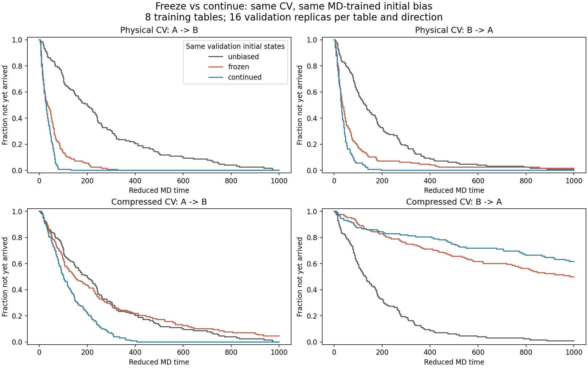

# 同一 MD 训练表：冻结与继续沉积的配对对照

2026-10-28，310_right，独立 benchmark。

## 更正原比较的含义

KINETICS.md 的旧冻结组使用上一轮 Metropolis 生成的压缩 CV 表，
在线组则从空表开始做 Langevin MD 沉积。二者的压缩 CV 定义相同，
没有把物理坐标表直接套到不同 CV 上；但表的训练来源、训练长度和是否继续更新同时变化。
旧实验可以比较这些不同协议，却不能隔离“冻结本身”的影响。

本轮严格在同一个 CV 定义内做配对：

    物理 CV x → 在线 Langevin 训练 → u_x* → 冻结 / 继续沉积
    压缩 CV f(x) → 在线 Langevin 训练 → u_f* → 冻结 / 继续沉积

u_x* 与 u_f* 各自训练，分别保存。两种 CV 的数值表没有互换。
“共用同一张表”只发生在同一 CV 的冻结与继续两条分支之间。

若将坐标从 x 改为可逆的 s=f(x)，且想保持原来的物理偏势，
需要 u_s(s)=u_x(f^{-1}(s))，不能直接复制 u_x 的横坐标和数值。
本轮比较的是各自 CV 上训练的偏势，而不是这个保持物理势不变的换坐标操作。

## 方法

沿用两自由度势能、BAOAB、m=kBT=gamma=1 和此前的两个稳定核心：
A 为 x,y 都小于 -0.6；B 为 x,y 都大于 0.6。
共享偏势为 B=0.5[u(s(x))+u(s(y))]。

每种 CV 独立训练 8 张表：
- 训练初态交替来自 A/B 的原始条件 Boltzmann 分布，速度为 Maxwell 分布。
- 训练 200 个约化 MD 时间单位，步长 0.0005；结束时间不依赖是否已经逃逸。
- 两个中心每 0.5 时间各沉积 height=0.02 的高斯，每张表共 800 个 hills。
- 物理坐标 sigma=0.12；压缩 CV sigma=0.02，与上一轮在线方案相同。
- 保存每张表的 HILLS、导数、SHA256 和对应 CV family。
- 训练 seed 为 187210+表编号；物理与压缩 family 使用相同的 seed 编排。

验证阶段使用独立的初态与热浴种子，每张表、每个方向 16 条轨迹，
合计每方向 128 条。验证 seed 为 821901+1000*表编号+副本编号。

同一个验证样本有三个分支：
1. 无偏；
2. 读入该 MD 表并冻结；
3. 读入同一张 MD 表并继续用相同参数沉积。

三者初始位置、速度相同；冻结/继续的初始偏势、物理力和热浴随机种子也相同。
验证是从相同的独立验证初态重新启动，不是把训练末态直接延续为验证轨迹。
这样既使用第二种在线算法产生的表，也把训练样本与验证样本分开。

两组 MD 时间步为 0.0005 和 0.00025，两个步长加载相同训练表。
每条验证最多运行 1000 时间；未到达者完整保留。
统计量为 RMST=E[min(T,1000)]，不能把高删失组的 RMST 当作无限时平均逃逸时间。

置信区间采用配对的两层 bootstrap：先重采样独立训练表，再重采样表内验证轨迹。
共 4000 次。这样不会把共享同一张随机训练表的 16 条验证轨迹视作完全独立训练重复。

## 结果

下表是更细步长 0.00025。“继续相对冻结的加速比”定义为 RMST_frozen/RMST_continued；
大于 1 为继续沉积更快。

| CV / 方向 | 冻结 RMST | 继续 RMST | 继续相对冻结的加速比 [95% CI] | 到达数：冻结 / 继续 |
| --- | ---: | ---: | --- | --- |
| 物理坐标 A→B | 53.71 | 31.73 | 1.693 [1.307,2.124] | 128/128 / 128/128 |
| 物理坐标 B→A | 79.32 | 33.61 | 2.360 [1.289,3.651] | 127/128 / 128/128 |
| 压缩 CV A→B | 258.01 | 130.48 | 1.977 [1.487,2.463] | 126/128 / 128/128 |
| 压缩 CV B→A | 700.19 | 798.71 | 0.877 [0.754,0.984] | 66/128 / 41/128 |

在 0.0005 下，相应比值为 1.681、2.207、2.032、0.904。
压缩 CV 反向在该步长下的置信区间 [0.743,1.039] 跨过 1。
两个步长间各组 RMST 差异的配对区间均包含零；当前统计精度下没有检出差异。

因此：
- 同一张表起步后，继续沉积对物理坐标的两个方向都有收益。
- 对本次压缩 CV，继续沉积改善正向，但没有改善反向；细步长数据支持反向减慢。
- 不能从旧的非配对实验推出“冻结普遍更差”，本轮也不支持这种概括。
- 结论限定于这套控制模型、固定训练时长和参数；未测 Al3Sc 成核速率。

图为 0.0005 的结果：

## 配对与数值核验

- 冻结/继续的初始 x,y,vx,vy、总偏势和两个物理力分量逐位相同。
- 第一轮新高斯之前，0.25 时间内的返回状态、步数和力诊断逐位相同。
- 冻结组新增 hill 数为零。
- 16 张训练表在全部验证完成后 SHA256 不变。
- 每张 MD 训练表与生产 HillBias 在 1001 个点核对：
  最大能量插值误差 2.06e-9、CV 导数误差 2.51e-5。
- 16 张表的完整物理力有限差分最大误差 9.87e-8。
- 对旧接口抽查无偏、冻结压缩、在线物理和在线压缩的既有轨迹；
  前 7 个动力学输出字段逐位保留。
- 新配对接口的冻结路径与旧冻结求值接口在相同表和初态下逐位一致。

实现中 Model 默认仍从空表开始在线运行。
新配对入口显式保留传入表，只由 continue_deposition 控制后续更新，
避免“继续”分支在初始化时意外把已训练表清零。

## 复现与文件

新增 kinetics_matched.py；扩展独立 kinetics_probe.cpp，
生产插件的 CV 和偏势算法未改动。

    cmake --build build/graph-tests --target zqc_shared_kinetics_probe -j 2
    python benchmarks/shared_frozen/kinetics_matched.py \
      --library build/graph-tests/benchmarks/graph/libzqc_shared_kinetics_probe.so \
      --inputs build/compression-extended \
      --output build/kinetics-matched \
      --training-tables 8 --replicas-per-table 16 \
      --training-duration 200 --training-step .0005 \
      --steps .0005 .00025 --cap 1000 --workers 4

inputs 只提供 cdf.table（定义压缩映射）与 zero.table（空表入口），
不会读取旧的 learned_compressed.table 或 learned_plain.table。
输出目录必须尚不存在。

310 原始结果：
/home/saitang/work/MetadToy-shared-probability-20261028/run-kinetics-matched

包含全部 16 张训练表与 HILLS、各组验证输出、summary.json 和图。
仓库 results/matched_md_20261028 保存摘要、图及两个 family 的首张示例表/HILLS。
kinetics_matched310.sh 与 matched_compatibility.py 保留运行和兼容性核验命令。
