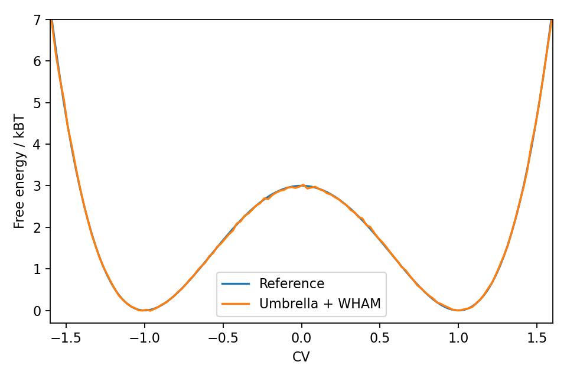
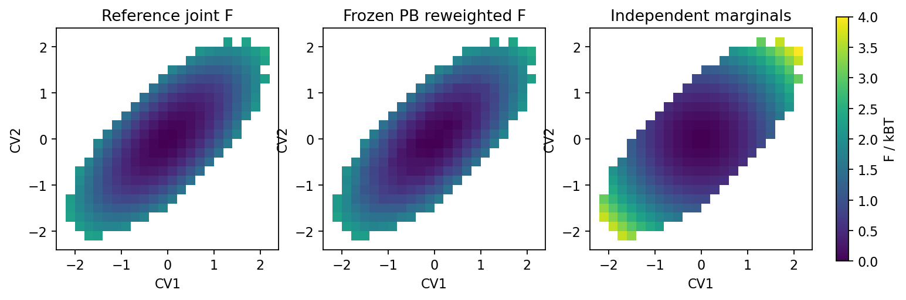

# 本次原型验证记录

主程序版本：`2d9ac7801ed7f093d5e83312f707e2167a337595`。原项目 **299 个已跟踪文件全部保持原样**。新增文件仅在 `prototypes/extension_lab/`，依赖与运行产物位于已忽略的 `build/extension_lab/`。

## 四项结果

| 原型 | 已实际运行的验证 | 结果 |
|---|---|---|
| GPU 数组 | 真实 GPUMD GPU_Vector、LAMMPS DAT DualView、两种坐标布局、NVRTC、跨流等待、owned/ghost、扩容后绑定、差分力 | PASS；力回写对解析值最大误差 `7.11e-15`，两次 Compute Sanitizer 均为 **0 errors** |
| 采样 | 18 个伞窗口，540,000 个样本，WHAM、WTMetaD 梯度和重启；4 rank 的两种副本划分 | PASS；WHAM RMSE `0.0206 kBT`，邻窗最小重叠 `0.544` |
| 模型与轨迹 | SavedModel、冻结 PB、ONNX；batch 1/7/64、多输出 VJP、坐标力、virial、80 帧 XYZ | PASS；VJP 方向导数最大误差 `1.22e-9`，坐标力误差 `7.03e-12`，virial 误差 `7.54e-12` |
| 高维 | 2/8/32/128 维 hill 梯度、完整协方差、周期边界、PBMetaD 沉积与重启、冻结偏置二维联合重加权 | PASS；高维梯度最大误差 `2.99e-10`，二维 FES RMSE `0.0358 kBT` |

MPI 交换：4 副本 × 1 rank 接受 122 次、拒绝 178 次；2 副本 × 2 rank 接受 1 次、拒绝 99 次。后者用于检验一个副本内多个 rank 的同步和交换，窗口间距较大，短测试的接受率不代表调优后的采样效率。

TensorFlow 2.17.0 的两种文件形式在 GPU 上求值；ONNX Runtime 1.20.1 使用 CPU。所有模型接收 NumPy batch，当前包含 Host/Device 数据传输。

二维验证使用 277,411 个冻结偏置样本，245 个有效样本数大于 400 的 bin。相同二维体系若按两个独立边缘近似，误差为 `0.550 kBT`，体现了配对轨迹保留相关性的必要性。

## 科学验证图





## 本机复现

以下命令使用已经存在的科学 Python 环境，以及本次单独安装到 build 目录的 ONNX 依赖；不会安装或升级该环境中的包。

```bash
cd /home/zqc/work/Metad-toy
OMPI_CXX=/usr/bin/g++ /home/zqc/apps/deepmd/bin/python \
  prototypes/extension_lab/run_all.py \
  --python-deps build/extension_lab/pydeps \
  --lammps-source /home/zqc/apps/lammps/lammps-stable_29Aug2024 \
  --gpumd-source build/extension_lab/GPUMD \
  --cuda-arch ADA89 \
  --cmake /home/zqc/apps/cmake/3.31.8/bin/cmake \
  --mpi-cxx /home/zqc/apps/deepmd/bin/mpicxx \
  --mpiexec /home/zqc/apps/deepmd/bin/mpirun \
  --mpi-extra=--oversubscribe --sanitize
```

移到其他机器时按上一层 README 的依赖安装方式建立独立环境，并替换上游源码位置。

## 验证边界

这些结果证明独立接口和算法在上述体系中通过检查。真实 MD timestep 接入、跨引擎邻居表与 ghost 通信、完整 MD 状态副本交换、模型设备张量零拷贝和持续沉积轨迹重加权仍需在合入阶段逐项验证。

高维单次求值耗时记录在 JSON 中，供定位测试成本；本次没有进行稳定态性能排名。力和 virial 的数值误差来自无量纲 demo 模型，不能当作真实势函数的物理精度。

机器可读的结果见本目录逐项 JSON，命令与日志路径见 `suite.json`，两次显存检查日志也保存在本目录。
